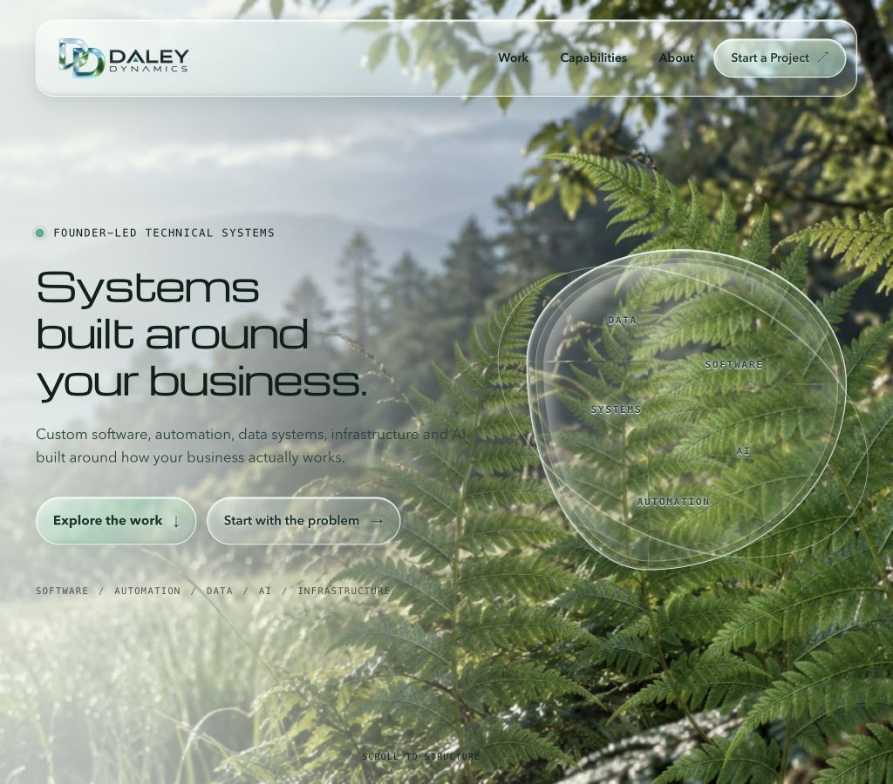

# Daley Dynamics website

I built this website for Daley Dynamics, my software and business systems brand. It uses semantic HTML, shared CSS and JavaScript, and an optional WebGL background. A small Node server handles project enquiries through SMTP.



You can run the site locally and test the enquiry form with a local SMTP sink. Production hosting and inbox delivery are unverified. The Work pages show placeholders while disclosure permission for the case studies is unconfirmed.

## What is implemented

The homepage, Capabilities, About and Start a Project pages share responsive navigation, keyboard focus styles and reduced motion support. The homepage includes capability links, expandable technical information and a project enquiry form. Both enquiry forms use the same browser module and backend endpoint.

The WebGL layer uses custom shaders for foliage movement and glass refraction. It adapts rendering quality and falls back to the static background when WebGL or an asset is unavailable. Page content and links remain ordinary HTML.

The enquiry backend validates fields, checks the request origin and body size, rejects honeypot and timing signals, and limits requests per process. Nodemailer sends plain text to a configured recipient with the validated visitor address as Reply-To. Success means the SMTP relay accepted the recipient, not that an email reached an inbox. There is no database, authentication, CMS or file upload service.

## Run locally

Use Node 22.13 or newer in the 22.x line, or Node 24+. Local validation used Node 24.11.1 and npm 11.6.2; GitHub Actions also passed on Node 22 and 24.

```bash
npm ci
npm run dev
```

Open `http://127.0.0.1:5173`. The Node server and Vite use the same origin. No credentials are needed to view the site. Without SMTP settings, a valid enquiry receives an unavailable response and the form remains available for retry.

For email delivery, copy `.env.example` to `.env.local` and provide server-side SMTP settings. Keep this file out of Git. `npm run dev` and `npm run preview` load it; `npm start` expects environment variables supplied by the host. Never put secrets in `VITE_` variables or frontend files.

```bash
npm run build
npm run preview
```

`npm run dev:web` starts only Vite and does not provide the enquiry endpoint. [Deployment notes](docs/deployment.md) explain the production server and a local SMTP sink that discards synthetic messages.

## Validation

```bash
npm run validate
```

This runs ESLint, Prettier, the 23 existing backend tests, the Vite production build and six HTTP integration checks. The integration checks start temporary loopback HTTP and SMTP listeners using synthetic data. They check routes, local links, fragment targets, built resources, cache headers, error responses, SMTP acceptance and missing configuration. They exclude inherited SMTP credentials.

Run `npm test` for the backend tests alone. Run `npm run build` followed by `npm run check:site` for the HTTP checks. Browser checks and dependency audit limits are recorded in [validation notes](docs/validation.md). [GitHub Actions](https://github.com/daley-tyler/daley-dynamics-website/actions/workflows/validate.yml) runs the same checks on Node 22 and 24.

## Project structure

| Path                                                        | Purpose                                                            |
| ----------------------------------------------------------- | ------------------------------------------------------------------ |
| `index.html`, `about/`, `capabilities/`, `start-a-project/` | Main pages and enquiry forms                                       |
| `work/`                                                     | Retained URLs with disclosure notices                              |
| `src/`                                                      | Shared styles, navigation, form handling and WebGL shaders         |
| `server/enquiry/`                                           | Validation, rate limiting, email composition and HTTP handling     |
| `server/index.js`                                           | Vite middleware in development; static build and API in production |
| `test/`                                                     | Backend tests using injected mail delivery                         |
| `scripts/`                                                  | Local SMTP sink and built-site integration checks                  |
| `public/`                                                   | Generated imagery, favicon and third-party font notice             |

Vite builds separate HTML entry points. There is no client-side router or frontend framework. Michroma is bundled locally through Fontsource; the site does not fetch a runtime font CDN.

## Assets

The nature imagery, fern and brand graphics were generated with Codex/ImageGen. [Asset provenance](docs/asset-provenance.md) records how each asset was made. Michroma is distributed under the included [SIL Open Font License](public/licenses/Michroma-OFL.txt). No source-code reuse license has been added.
